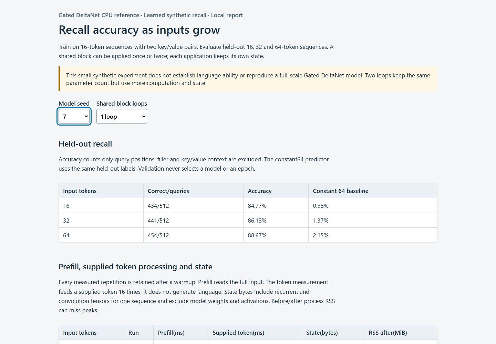

# Recurrent State Lab

Inspect a small recurrent model's recall, carry its state across chunks, and compare one or two applications of the same block on a CPU.



[Open the measured demo](docs/demo-report.html) · [Usage](docs/USAGE.md) · [Implementation](docs/IMPLEMENTATION.md) · [Validation](docs/VALIDATION.md)

## Try it

Use Python 3.12. Install a CPU build of PyTorch, then this package:

```sh
python -m venv .venv
# Activate: PowerShell .\.venv\Scripts\Activate.ps1; sh source .venv/bin/activate
python -m pip install torch==2.14.1+cpu --index-url https://download.pytorch.org/whl/cpu
python -m pip install -r requirements-verified.txt
python -m pip install ".[test]"
python -m recurrent_state_lab.cli --output runs/demo
```

Open `runs/demo/report.html`. Compare two seeds and one/two shared loops. The run trains four small models locally, retains every score/timing repetition, and writes tensor checkpoints. It does not download pretrained weights or call a service. Choose a new output directory for each run.

For a short installation check, use `--epochs 1 --train-examples 32 --seeds 7`. Smoke scores do not establish model quality. Run `python -m pytest -q` for the checks.

## What it shows

- **Recall across longer inputs:** train at 16 tokens, evaluate separate 16/32/64-token rows, and keep unsuccessful comparisons visible.
- **Explicit streaming state:** full, split and one-token execution agree; reset is `state=None`, with independent state for each request and each shared loop.
- **The cost of another loop:** 28,292 unique parameters in either model; a second loop increases work and doubles state. Parameters and compute are separate.

The four local default conditions scored 88.67–98.44% at 64 tokens. One seed benefits from two loops; the other favors one loop. This is a small synthetic two-key task. It does not establish language-model capability or general superiority.

## Added here

A usable CPU reference binding around the retained GatedDeltaNet layer, explicit returned state, separate states for shared loops, bounded learned evaluation, safe output creation and an offline report. Tests cover state/gradient parity, actual reference dispatch and unsupported inputs. Full GPU execution and mixed precision are outside this reference path.

Code: [`reference.py`](src/recurrent_state_lab/reference.py), [`zoology.py`](src/recurrent_state_lab/zoology.py), [`experiment.py`](src/recurrent_state_lab/experiment.py), [`tests`](tests/). Copied implementation/license details and matched papers are in [research notes](docs/RESEARCH.md). New code is MIT; copied FLA/Zoology code keeps MIT/Apache 2.0 terms.

Local installed-package validation: 176 tests passed, four learned runs repeated exactly in parameters/scores, and checkpoint readback matched. GitHub CI and publication remain pending. See [validation](docs/VALIDATION.md) for dates, environment, limits and all results.
